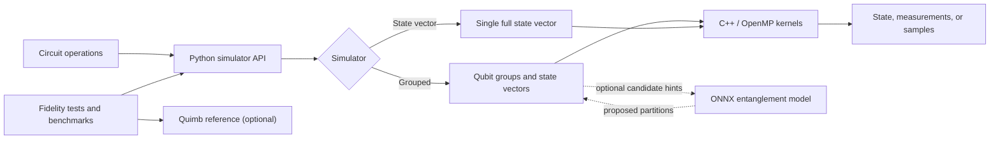

# ML-QDES

**ML-QDES** means **Machine Learning-based Quantum Dynamic
Entanglement-aware Simulator**. It is a Python quantum-circuit simulator with
a C++/OpenMP numerical backend, andoptional ONNX-assisted entanglement partitioning.

ML-QDES evolves pure quantum states and offers a grouped simulator that can
split separable subsystems into smaller state vectors. This can reduce the
amount of state-vector work for circuits whose qubits remain weakly entangled.
The project also includes state-vector fidelity checks, benchmark runners, and
optional model-training utilities.

> ML-QDES is a research and simulation project, not a fault-tolerant quantum
> computing platform. Benchmark results depend on the circuit, hardware,
> compiler, Python environment, and optional dependencies.

## Contents

- [Highlights](#highlights)
- [How it fits together](#how-it-fits-together)
- [Requirements and installation](#requirements-and-installation)
- [Quick start](#quick-start)
- [Simulators and API](#simulators-and-api)
- [Supported gates](#supported-gates)
- [Testing and validation](#testing-and-validation)
- [Benchmarks](#benchmarks)
- [Optional entanglement model](#optional-entanglement-model)
- [Repository map](#repository-map)
- [License and authorship](#license-and-authorship)

## Highlights

- **Grouped simulation:** `QuantumSystem` tracks qubits in separate groups and
  merges groups when gates couple them. It checks candidate separations before
  splitting a group again.
- **C++ numerical kernels:** state-vector gate application, sampling, and
  entanglement-related operations are provided by the `utils_cside` extension.
- **Inverse-CDF sampling:** seeded sampling is deterministic for a fixed
  environment and input. Independent groups use distinct deterministic random
  streams when their samples are combined.
- **Reference implementations:** plain and gate-fusion state-vector simulators
  are available for comparison and validation.
- **Optional inference and training:** the grouped simulator can use an ONNX
  model to propose candidate partitions. Exact checks still validate candidate
  separations. Model training is a separate, optional workflow.

## How it fits together



The optional inference model is used by the grouped simulator to suggest
possible partitions. It is not required to use the core simulators. A model
file can be selected with `QDES_MODEL_PATH`; otherwise ML-QDES searches the
repository's `model_files/` directory.

## Requirements and installation

### Requirements

- Python **3.9 or newer**
- NumPy **1.23 or newer**
- A C++14 compiler and the Python/NumPy/pybind11 build headers
- OpenMP support for the default non-Windows extension build

The base package builds its `qdes.utils_cside` extension during installation.
Use a virtual environment so the build and runtime dependencies are isolated:

```bash
git clone https://github.com/ffunctia/QDES.git
cd QDES
VENV_DIR="my-ml-qdes-env"
source "$VENV_DIR/bin/activate"
python -m pip install --upgrade pip
python -m pip install -e .
```

Choose any environment directory name you prefer in `VENV_DIR`; the example
uses `my-ml-qdes-env`. For editable development installs, `-e .` keeps Python
imports pointed at the checkout. For a regular install, use
`python -m pip install .`.

### Optional development and validation dependencies

Install the declared test extras to run the fidelity checks:

```bash
python -m pip install -e ".[test]"
```

The repository's `requirements-tests.txt` also includes `kahypar`, used by
some reference/utility workflows:

```bash
python -m pip install -r requirements-tests.txt
```

`torch` and `onnx` are only needed to train or regenerate the optional model.
They are not required for ordinary simulation.

### Alternative setup script

`configure.sh` automates installation inside whichever virtual environment is
already activated and prompts about model/data workflows. Read its prompts
carefully: some choices remove and regenerate `model_files/` and can start a
long training run. Manual installation above is the non-interactive core setup.

### CMake build

The extension can also be built with CMake when Python development headers,
NumPy, pybind11, a C++14 compiler, and (optionally) OpenMP are available:

```bash
cmake -S . -B build
cmake --build build --parallel
```

The resulting module is placed under `build/qdes/`. For the usual Python
installation workflow, `python -m pip install .` builds and installs the
extension into the active environment.

## Quick start

```python
from qdes import QuantumSystem

# Prepare a three-qubit GHZ state: (|000> + |111>) / sqrt(2)
system = QuantumSystem(3)
system.apply("H", [0])
system.apply("CX", [0, 1])
system.apply("CX", [0, 2])

print("Entanglement groups:", system.custom_group_sizes())
print("4096 shots:", system.sample(count=4096, seed=42))
state, qubit_order = system.full_state()
print("Qubit order:", qubit_order)
print("State vector:", state)
```

## Simulators and API

| Class | Module | Description |
|---|---|---|
| `QuantumSystem` | `qdes.simulator` | Grouped simulator; combines and checks separable subsystems. |
| `StateVectorQuantumSystem` | `qdes.sv_simulator` | Plain state-vector reference simulator. |
| `StateVectorQuantumSystem` | `qdes.sv_simulator_gf` | State-vector simulator with gate fusion. |

The two state-vector implementations have the same class name; import the
module that identifies the implementation you want.

### Core operations

```python
system.apply("RY", [0], 0.5)  # Apply a named gate with parameters
system.apply("CX", [0, 1])    # Apply a two-qubit gate
outcome = system.measure(0)   # Measure one qubit; returns 0 or 1

counts = system.sample(count=1000, seed=7)
samples = system.sample(count=1000, return_counts=False, seed=7)
```

- `apply(gate, target_qubits, *params)` applies a named gate in
  `QuantumSystem`. The state-vector simulators accept a gate matrix and target
  qubits; see [Supported gates](#supported-gates).
- `measure(qubit)` measures one qubit and updates/collapses the simulator state.
- `sample(target_qubits=None, count=1000, return_counts=True, seed=None)`
  samples without collapsing the state. By default, it samples all qubits.
  With `return_counts=True`, the result maps bit strings to counts; otherwise
  it returns an array of integer outcomes.
- `custom_group_sizes()` reports the grouped simulator's current group sizes.
- `full_state()` returns the full state vector and the corresponding qubit
  ordering.

Passing a seed makes sampling repeatable for the same code and environment.
Exact output sequences can differ across changes to the random-number
implementation or runtime environment; reproducibility claims should record
the QDES revision and relevant software environment.

## Supported gates

Gate matrices and constructors are available from `qdes.gates`. `QuantumSystem`
also accepts gate names in `apply`.

| Category | Gates |
|---|---|
| Single-qubit fixed | `X`, `Y`, `Z`, `H`, `S`, `SDG`, `T`, `TDG`, `SX` |
| Single-qubit parameterized | `RX(θ)`, `RY(θ)`, `RZ(θ)`, `P(φ)`, `U3(θ, φ, λ)` |
| Two-qubit fixed | `CX`, `CZ`, `SWAP` |
| Two-qubit parameterized | `CP(φ)`, `CRX(θ)`, `CRY(θ)`, `CRZ(θ)`, `RXX(θ)`, `RYY(θ)`, `RZZ(θ)` |

The order of target qubits matters for multi-qubit gates; for example,
`system.apply("CX", [control, target])` places the control first.

## Testing and validation

Run commands from the repository root. Setting `PYTHONPATH` explicitly makes
the tests import this checkout rather than a different installed `qdes`
package:

```bash
PYTHONPATH="$PWD/src" python -m pytest -q tests/test_sampling.py
PYTHONPATH="$PWD/src" python tests/uni_test.py 100 42 5
```

The first command checks the joint sampling distribution of two independent
Hadamard qubits and verifies deterministic behavior for a fixed seed. The
second runs interleaved grouped-simulator/state-vector fidelity and grouping
checks; its positional arguments are number of tests, seed, and qubit count.
The current `uni_test.py` accepts the seed argument but does not reseed its
random circuit generator from it, so this command should not be treated as
producing an identical circuit sequence on every run.

Quimb-based state-vector comparisons use 8-qubit, 122-operation circuits and
run 1000 cases by default. They can be launched separately:

```bash
PYTHONPATH="$PWD/src" python tests/sv_quimb_fidelity.py 42
PYTHONPATH="$PWD/src" python tests/sv_gf_quimb_fidelity.py 42
```

These longer fidelity suites are separate from the focused sampling regression
test. Quimb must be installed first; see [Optional development and validation
dependencies](#optional-development-and-validation-dependencies).

## Benchmarks

The benchmark compares ML-QDES, the gate-fusion state-vector simulator, and
Quimb on generated circuits. It reports circuit/grouping metrics, elapsed time,
and peak resident memory; it is a performance runner, not a
sampling-distribution correctness test.

```bash
# Generate one circuit for each configured qubit size (16, 20, 24, 28)
bash run_benchmarks.sh 1

# Use the default: 25 circuits per configured qubit size
bash run_benchmarks.sh
```

The script uses the active `python3` by default. Override it with
`PYTHON_BIN=/path/to/python bash run_benchmarks.sh 1` if needed. The optional
Quimb benchmark requires Quimb to be installed.

Generated circuit files are placed temporarily in `temp/circuits/`, temporary
benchmark data in `temp/benchmarks/`, and the combined output is written to
`final_performance_results.csv` in the repository root. The temporary circuit
and benchmark files are removed at the end. Larger qubit configurations can
take substantial time and memory; begin with a small test count.

## Optional entanglement model

The grouped simulator can use an ONNX model to propose entanglement
partitions. To select a model explicitly:

```bash
export QDES_MODEL_PATH="/path/to/entanglement_model.onnx"
```

By default, ML-QDES looks for `model_files/entanglement_model.onnx` in the
current repository and package-relative locations. Model training/data
generation lives in `training/generate_dataset_and_train.py` and requires
optional PyTorch/ONNX dependencies. Training can be computationally expensive;
it is not part of the standard install or quick-start workflow.

## Repository map

```text
ML-QDES/
├── csrc/                 C++/OpenMP numerical extension
├── model_files/          Optional trained model assets
├── src/qdes/             Python package and simulator APIs
├── tests/                Fidelity, sampling, and benchmark runners
├── training/             Dataset generation and model training
├── configure.sh          Interactive environment/model setup
└── run_benchmarks.sh     Circuit generation and performance runner
```
